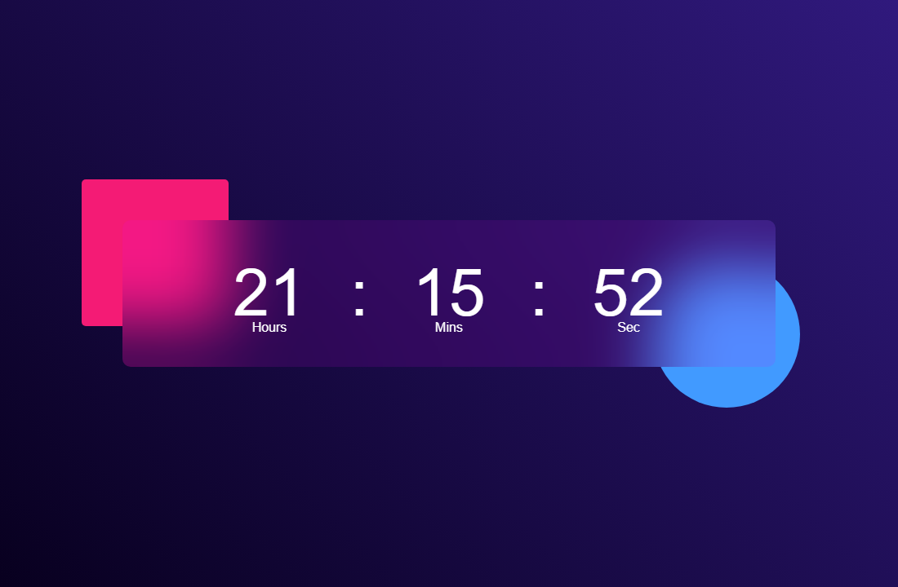
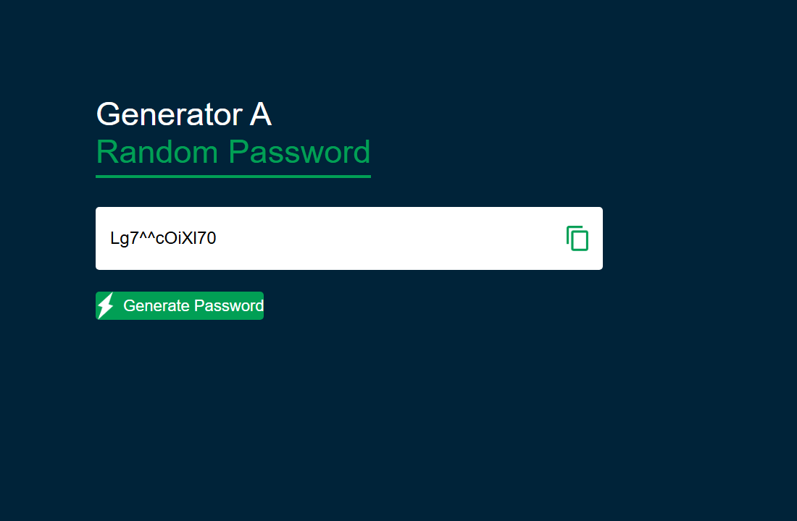
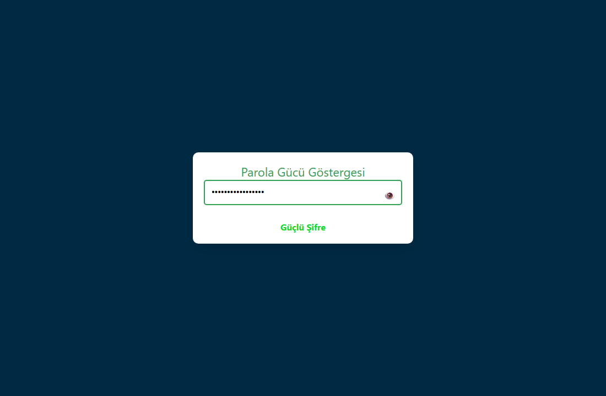
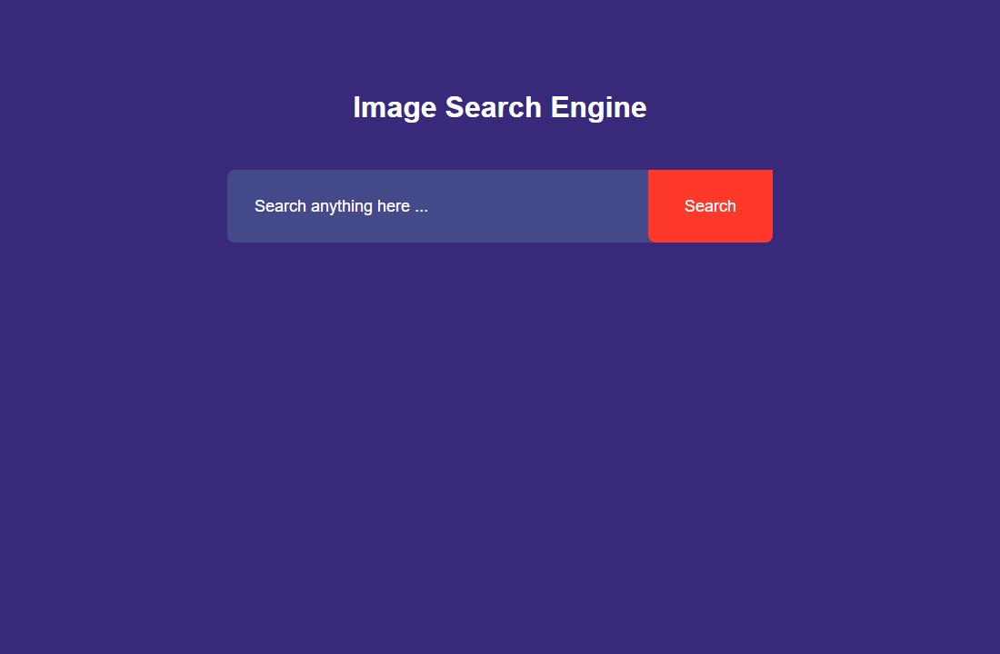
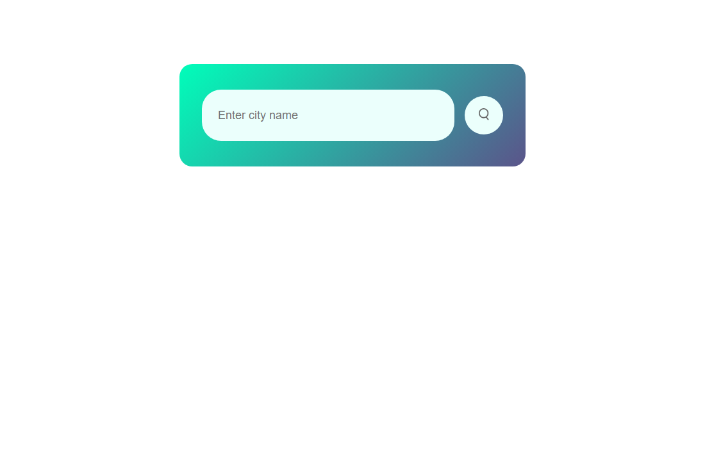
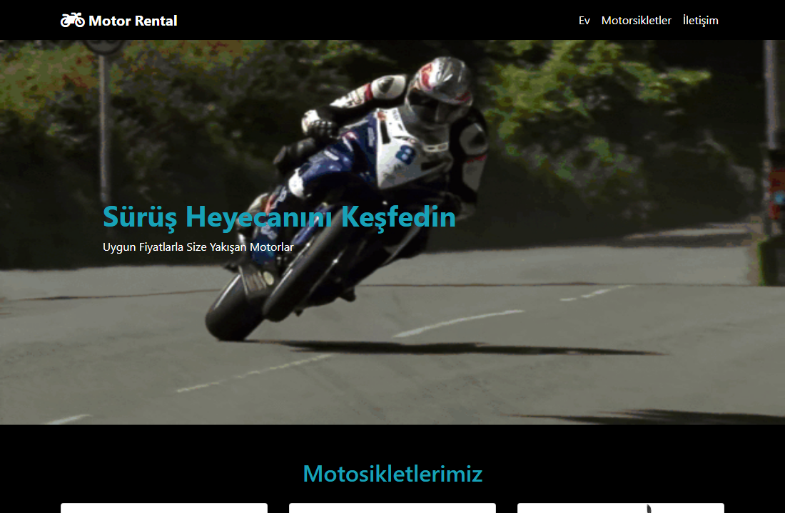
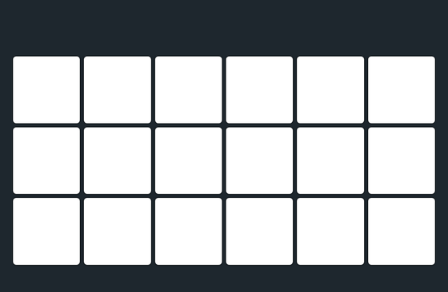

# Mini projeler

Eski küçük alıştırma depoları tek depoda. Her klasör eski bir depodur; git geçmişi korundu.

## Ekran görüntüleri

Web projeleri (tarayıcıda yerelde açıldı; dış API çağrılmadı):

| Dijital saat | Rastgele şifre | Parola gücü |
|---|---|---|
|  |  |  |

| Görsel arama | Hava durumu | Motor kiralama |
|---|---|---|
|  |  |  |

Java (Swing), Python, Android ve notebook projeleri bu sayfada görselsiz.

## Kullanım

- Web projeleri: klasördeki `index.html` dosyasını tarayıcıda açın.
- Hava durumu ve görsel arama dış API kullanır (OpenWeatherMap, Unsplash); internet gerekir.
- Diğer projelerin çalıştırma notu kendi klasöründeki README'de.

## java

- [AdamAsmacaOyunu](java/AdamAsmacaOyunu) — Adam Asmaca Oyunu
- [KronometreTherad](java/KronometreTherad) — Kronometre Thread Java Uygulaması
- [SnakeGame](java/SnakeGame) — Snake-java
- [MayinTarlasi-gui-swing](java/MayinTarlasi-gui-swing) — Mayın Tarlası Oyunu
- [HesapMakinesi-gui-swing](java/HesapMakinesi-gui-swing) — Hesap Makinesi Uygulaması
- [workingWithFiles](java/workingWithFiles) — Dosya İşlemleri Java Uygulaması
- [Gorev-Yonetim-Sistemi](java/Gorev-Yonetim-Sistemi) — Görev Yönetim Sistemi

## python

- [dictionary](python/dictionary) — Kelime Tahmin Oyunu
- [KalpliYazi](python/KalpliYazi) — Kalp Şekli Çizimi ve Mesaj Ekleme
- [KalemCizmiDonusturucu](python/KalemCizmiDonusturucu) — Gelişmiş Çizim Görüntü Üretici
- [Student-Management-System](python/Student-Management-System) — Öğrenci Yönetim Sistemi

## yapay-zeka

- [AnimalClassification](yapay-zeka/AnimalClassification) — Animal Classification with CNN
- [Resim-analizi](yapay-zeka/Resim-analizi) — 🚀 Gemini 2.0 Flash Chat Interface 🤖
- [CokAmacliSohbetAsistani](yapay-zeka/CokAmacliSohbetAsistani) — Çok Amaçlı Sohbet Asistanı
- [YouTube-Video-Summarizer-Translator](yapay-zeka/YouTube-Video-Summarizer-Translator) — 📺 YouTube Video Summarizer/Translator

## veri-analizi

- [TitanicveTipVeriSetleriAnalizi](veri-analizi/TitanicveTipVeriSetleriAnalizi) — Titanic ve Tips Veri Setleri Analizi
- [FinansTabloGrafik](veri-analizi/FinansTabloGrafik) — Hisse Senedi Veri Görselleştirme ve Analiz Aracı
- [PotansiyelMusteriGetirisi](veri-analizi/PotansiyelMusteriGetirisi) — Gezinomi Veri Analizi Projesi
- [BikeStoreSales](veri-analizi/BikeStoreSales) — BikeStoreSales Dataset Analysis
- [coffeeShopSales](veri-analizi/coffeeShopSales) — Coffee Sales Data Analysis

## web

- [Digital-Clock-Using-](web/Digital-Clock-Using-) — Dijital Saat
- [RandomPasswordUsing](web/RandomPasswordUsing) — Rastgele Şifre Üretici
- [ParolaGucuGostergesi](web/ParolaGucuGostergesi) — Parola Gücü Göstergesi
- [Image-Search-Engine](web/Image-Search-Engine) — Görsel Arama Motoru
- [WeatherApp](web/WeatherApp) — Weather App
- [HafizaKartOyunu](web/HafizaKartOyunu) — Hafıza Kart Oyunu
- [QuizApp](web/QuizApp) — Quiz Uygulaması
- [Online-NoteBook](web/Online-NoteBook) — Çevrimiçi Not Defteri
- [MotorRentaCaR](web/MotorRentaCaR) — Motor Kiralama Web Sitesi

## android

- [NavigationDrawer](android/NavigationDrawer) — Navigation Drawer Menu Project
