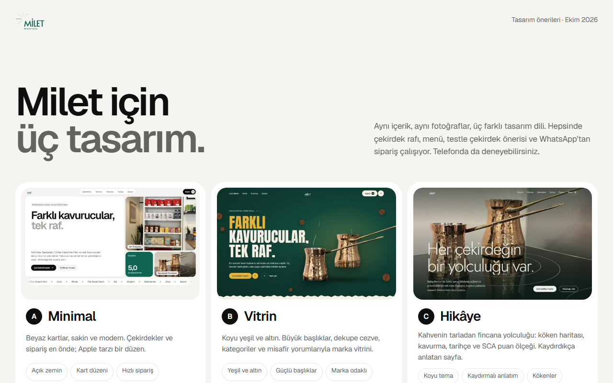
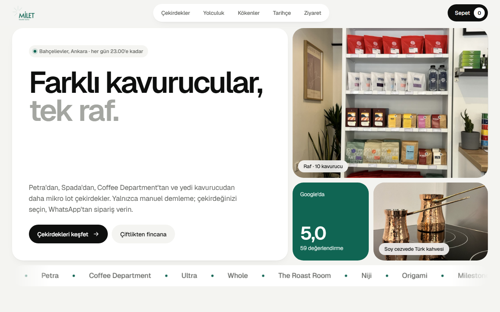
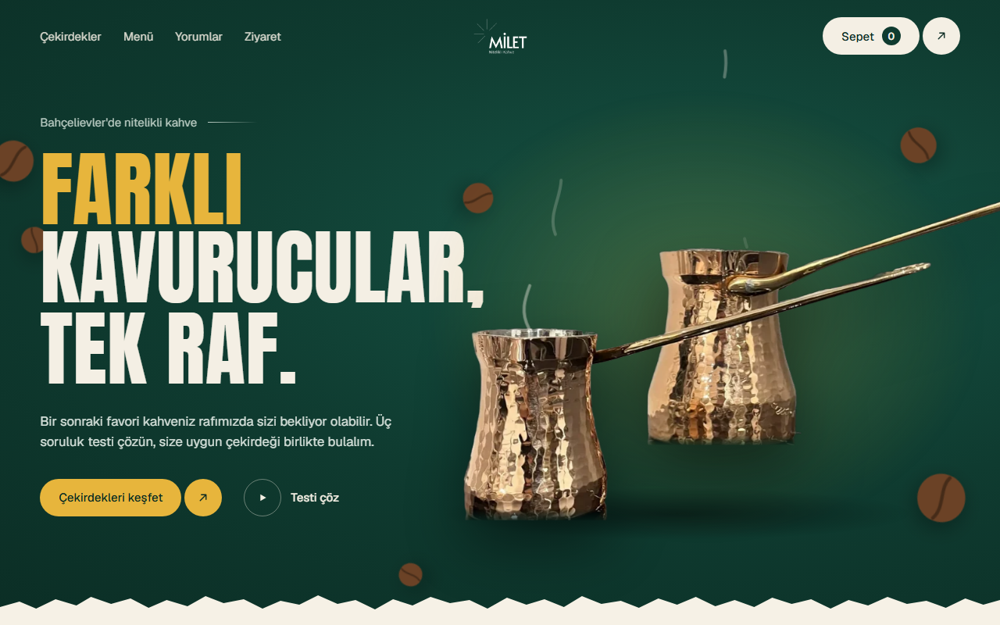
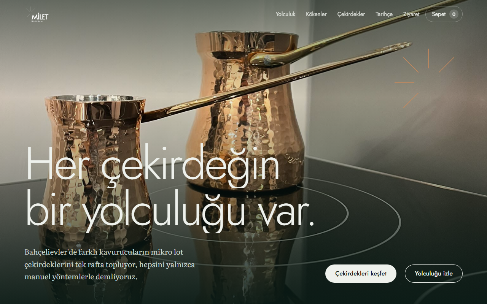
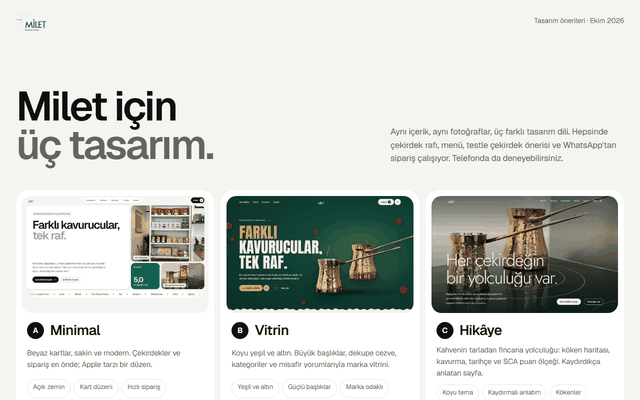

# Milet Coffee — üç tasarım önerisi

Bahçelievler'deki Milet Coffee için demo site. Aynı içerik ve fotoğraflar üç ayrı tasarım dilinde.
Hepsinde çekirdek rafı, menü, testle çekirdek önerisi ve WhatsApp'tan sipariş çalışır.
Saf HTML/CSS/JS; kurulum gerekmez.

| Klasör | Tasarım |
|---|---|
| `minimal/` | A · Minimal: beyaz kartlar, sakin ve modern; çekirdekler ve sipariş önde. |
| `vitrin/` | B · Vitrin: koyu yeşil ve altın, büyük başlıklar, dekupe cezve, misafir yorumları. |
| `hikaye/` | C · Hikâye: tarladan fincana yolculuk; köken haritası, kavurma, tarihçe, SCA puanı. |

## Ekran görüntüleri



| A · Minimal | B · Vitrin | C · Hikâye |
|---|---|---|
|  |  |  |

## Kullanım



1. Ana sayfada üç tasarımdan birini seçin.
2. Sayfayı kaydırın: çekirdek rafı, menü ve çekirdek önerisi testi gelir.
3. Çekirdeği sepete ekleyin; sipariş WhatsApp mesajı olarak hazırlanır.

## Yerelde çalıştırma

```bash
python -m http.server 8103
```

Aç: http://127.0.0.1:8103/
